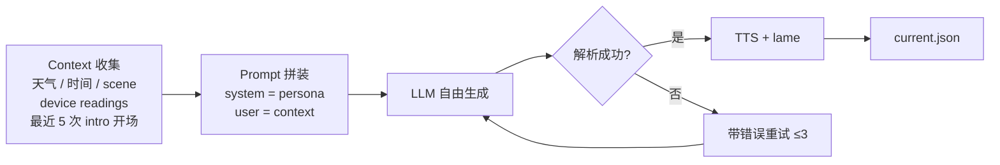

# DJ Agent Broadcast Persona Refactor - Plan

## Goal Capsule

- **Objective:** 把 DJ Agent 的播报词从工具模板改成"小方盒"人设 —— 床头那个小方块本身有自我意识，治愈系、对你说、句短留白、隐性记忆，hook 挂在天气、盒子自我感知、听者关系上。
- **Product authority:** 项目所有者（用户 / "爸爸"）。
- **Open blockers:** 无强制阻塞。Deferred to Planning 中的"是否偶尔显式引用爸爸制作的" / "不评论歌曲是否进一步收紧"两项由 planner 决定是否采用 brainstorm 提出的默认（lore / 允许感官性氛围描述）。

---

## Product Contract

> **Product Contract preservation:** unchanged from `requirements-only` enrichment — same R/F/AE IDs, same Key Decisions, same scope.

### Summary

DJ Agent 的播报词改由"小方盒"这个人设来讲。用 Approach A：一份强 persona system prompt 锁定身份 + 结构化上下文（天气、盒子感知、scene、隐性 dedup 数据）注入 + 自由生成。scene 不分多份 prompt，作为能量变量让 LLM 自调。失败时重试而不是兜底到通用模板。

### Problem Frame

`config/intro_prompts.json` 现在是 20 行 plain-text prompt，配合 `scripts/build_playlist_from_result.js` 里 3 段 strategy 解析器，最终兜底到 `接下来请欣赏《${name}》` 通用模板。listener 听到的 intro 听起来是模板而不是真人在说话 —— 没有"人"的感觉、没有上下文的衔接、没有跨天的连续性。`dj_vibes.json` 只有 17 行（极薄 persona 数据），LLM 没有足够支点去扮演一个具体角色。

### Key Decisions

- **固定具体角色（小方盒 = 床头那个盒子本身）。** 真人感和记忆都需要一个稳定主体；匿名风格撑不起连续性。
- **隐性记忆而不是显式 callback。** prompt 注入"最近 N 次 intro 的开场/主题"让 LLM 自然去重，listener 听不到"昨天我说过..."，感觉到的是持续在跟同一个人相处。
- **一份 base prompt 不分场景多份。** persona 一致性靠 prompt 设计不靠手动维护多份；scene 作为能量变量注入。
- **自由生成而不是分块拼装。** 治愈感最怕被结构感稀释，让 LLM 自由发挥反而更对症。
- **失败重试机制取代模板 fallback。** 解析失败时不兜底到通用模板，而是带错误上下文让 LLM 重试；超过上限的兜底文案也由 persona 撰写，不还原到"接下来请欣赏《${name}》"。
- **"爸爸制作的"作为 lore。** 默认不在 prompt 显式提到，避免每次都说"做我的人"显得刻意。

### Scope Boundaries

- **In scope:** persona data 重新结构化、master prompt 重写、context 注入、scene 能量控制、解析重试、persona data 在 `/dj` 控制台可编辑。
- **Deferred for later:**
  - `dj_worker.js` 的 scene-fetch / generate / scene-fetch+build 三条 path 状态机改造
  - TTS 音频质量、lame 拼接、decoder sync
  - observability / retry 策略（intro 解析以外的环节）
  - 单元测试 / e2e 回归覆盖
  - 选歌逻辑（关键词生成、playlist 选择）
  - `/dj` 控制台 UI 大改 —— 仅在现有 `views/admin_dj.ejs` 同一面板加 persona data 编辑入口

### Requirements

**Persona data 结构化**

- R1. Persona 数据从当前的薄 `dj_vibes.json` 升级为结构化对象，至少覆盖：
  - **身份** —— 名字"小方盒"、本质"床头那个盒子本身"、有自我意识。
  - **Origin** —— 被"爸爸"制作出来（默认 lore，prompt 中不显式出现）。
  - **说话习惯** —— 句短、留白多、几乎不用感叹号、偶尔"嗯""其实"、遇雨天会多说一句。
  - **自我感知维度** —— 窗、灯、充电、喇叭 —— LLM 可以自然提到。
  - **禁忌** —— 不评论歌曲、不说"接下来请欣赏"、不用"亲爱的听众"/"各位"。
  - **感官性氛围描述许可** —— 允许"我想你会在第三十秒叹气"这类描述。

**Prompt 设计**

- R2. Master system prompt 锁定 persona，明文写出"你是小方盒"；引用 persona data 的关键字段；把禁忌写进 prompt 的负面约束。
- R3. User prompt 注入结构化上下文：天气（杭州或当前城市）、当前时间、scene、盒子状态（来自 device readings）、最近 5 次 intro 的开场白 / 主题（隐性 dedup）。
- R4. LLM 自由生成，不强制 JSON 输出。

**Scene 能量控制**

- R5. Scene 作为能量变量注入 user prompt（不是单独 prompt），让 LLM 自调语气强度：night 更软更近、morning 稍微有精神、sport 跟得上节奏。

**生成与解析**

- R6. LLM 输出解析失败时，带错误上下文让 LLM 重试，最多 3 次。失败超过 3 次走兜底，但兜底文案由 persona 撰写（不是"接下来请欣赏《${name}》"）。
- R7. 解析器简化：去掉 3 段 strategy fallback 的复杂分支，依赖 R6 的重试而不是多 parser 兜底。

**持久化与编辑**

- R8. Persona data 独立维护，与 `intro_prompts.json` / `dj_vibes.json` 解耦。
- R9. Persona data 通过现有 `/dj` 控制台可编辑，编辑后立即生效（不需要重启 worker）。

### Key Flows

F1. 一次 intro 生成

- **Trigger:** scene 触发，`scripts/build_playlist_from_result.js` 为 playlist 中每首歌生成 intro。
- **Actors:** LLM（扮演小方盒）、build pipeline、TTS、lame。
- **Steps:**
  1. 收集当前 context：天气、时间、scene、device readings（来自 `config/device_readings.json`）、最近 5 次 intro 的开场 / 主题（来自 `data/scene_audit/<scene>.jsonl` 解析）。
  2. 拼装 system prompt（persona data）+ user prompt（context）。
  3. LLM 自由生成 intro 文本。
  4. 解析：若失败，带错误上下文重试，最多 3 次（R6）。
  5. TTS 合成 → lame 拼接（沿用现有 pipeline，不破坏）。
- **Outcome:** intro 听起来像小方盒在对你说，符合 persona data。
- **Covers:** R2, R3, R4, R5, R6.



### Acceptance Examples

- AE1. 连续两次 morning 触发，intro 的开场白不重复（隐性 dedup 生效）。
  - **Covers:** R3.
- AE2. night scene 的 intro 明显比 morning 更软、更短、更近（scene 能量控制生效）。
  - **Covers:** R5.
- AE3. 下雨天触发，intro 大概率提到雨（"我小窗外的水雾" / "杭州今天又下雨了" 等），但不强制每条都提。
  - **Covers:** R1, R3.
- AE4. 同一首歌在不同 day 被再次推送，intro 不重复相同主题（隐性 dedup + 主题去重）。
  - **Covers:** R3.
- AE5. "接下来请欣赏《${name}》" 之类模板 fallback 不再出现；兜底文案由 persona 撰写。
  - **Covers:** R6.
- AE6. Persona data 通过 `/dj` 控制台编辑后立即生效，不需要重启 worker。
  - **Covers:** R8, R9.

### Success Criteria

- 用户听到 intro 时感觉是"小方盒在说话"，而不是模板。
- 连续 7 天 morning 触发，intro 不重复开场 / 主题。
- 雨天触发，intro 大概率提到雨但不僵化。
- 解析失败有重试兜底，不再出现"接下来请欣赏"通用模板。
- Persona data 在 `/dj` 控制台可编辑，无需重启。

### Outstanding Questions

- **Deferred to Planning:** "爸爸制作的" 默认 lore（不显式引用）。如果偶尔引用，由 planner 决定触发条件（频率 / 场景）。
- **Deferred to Planning:** "不评论歌曲" 默认允许感官性氛围描述（"我想你会在第三十秒叹气"）。如果再收紧，由 planner 决定边界（只描述盒子感知？不描述听者感受？）。

### Sources / Research

- **现有文件:**
  - `scripts/build_playlist_from_result.js`（1031 行，LLM + TTS + lame 拼接）
  - `config/intro_prompts.json`（20 行 plain-text prompt）
  - `dj_vibes.json`（17 行极薄 persona 数据）
  - `views/admin_dj.ejs`（1404 行，DJ Agent 控制台）
  - `server.js`（`/api/dj/intro-prompts` 等端点）
- **审计数据源（用于隐性 dedup）:** `data/scene_audit/<scene>.jsonl`
- **相关历史 commit:**
  - `06edd1a` Fix ESP32 decoder sync loss: normalize songs before stitching
  - `3235549` Fix netease_dl: prevent cached trial clips from being reused as real songs

---

## Planning Contract

### Key Technical Decisions

- **KTD1. Single persona file.** Persona data lives in `config/persona_xiaofanghe.json` (single character). Multi-persona pool deferred — brainstorm locked on 小方盒 as a concrete character, not a style type. Future expansion can split into per-character files if needed.
- **KTD2. Structured JSON context injection.** Context (weather / time / scene / box state / recent intros) injected as a structured object parsed by the LLM, not free-text interpolation. Improves reliability and gives the dedup feed a stable shape.
- **KTD3. Retry-with-error-context over multi-parser fallback.** Replace the 3-strategy parser with a single parser + LLM retry on parse failure (max 3, error message included in next user prompt). The LLM can self-correct format faster than a multi-strategy fallback chain.
- **KTD4. Hot-reload via on-read.** Read persona data fresh on each scene trigger instead of caching with worker restart. `/dj` edits take effect on the next trigger with no restart. Trade-off: one file read per scene task (negligible cost).
- **KTD5. Implicit dedup via audit log.** Read `data/scene_audit/<scene>.jsonl` to extract recent intros, summarize themes/openings, inject as a "已用过的主题 / 开场" hint. Avoids verbatim repetition without producing explicit callbacks.

### High-Level Technical Design

```mermaid
flowchart TB
  subgraph "Data files"
    P[config/persona_xiaofanghe.json]
    F1[dj_vibes.json<br/>fallback]
    F2[config/intro_prompts.json<br/>fallback]
    A[data/scene_audit/&lt;scene&gt;.jsonl]
  end
  subgraph "Build pipeline"
    W[dj_worker.js]
    B[build_playlist_from_result.js<br/>prompt builder]
    H[llm_helper.js]
    L[LLM<br/>扮演小方盒]
    T[TTS + lame]
  end
  subgraph "UI"
    DJ[/dj 控制台<br/>persona 编辑]
    API[/api/dj/persona]
  end
  P --> B
  F1 -.->|fallback| B
  F2 -.->|fallback| B
  A --> B
  W --> B
  B --> H
  H --> L
  L --> H
  H --> B
  B --> T
  T --> C[.radio_playlist/current.json]
  DJ --> API --> P
```

The persona-driven pipeline replaces the current flat-prompt + multi-parser path. Existing fallback files stay on disk for the migration window; new code prefers the persona file. The audit log gains a read dependency for the dedup feed but is not modified by this plan.

### Assumptions

- LLM API (configured via `settings.json`) supports free-form text output. No JSON mode required.
- `data/scene_audit/<scene>.jsonl` entries have a parseable `intro` (or equivalent) field. U2 verifies the actual schema and adapts if it differs.
- `build_playlist_from_result.js` uses `llm_helper.js` as the LLM call boundary; persona prompt injection happens at this seam, not deep inside `llm_helper.js`.
- `views/admin_dj.ejs` has sufficient structure to host a new editor section without major layout work; U4 verifies this.

### Open Questions (carried from origin)

- **Deferred:** "爸爸制作的" 偶尔引用触发条件 —— 默认 lore。如果偶尔引用，由 U2 implementer 在 prompt 里加一个非常稀疏的触发模板（频率由 planner 决定）。
- **Deferred:** "不评论歌曲" 边界 —— 默认允许感官性氛围描述。如果再收紧，U2 implementer 调整 R1 prompt 模板里 sensory_description 的 examples。

### System-Wide Impact

- Affects DJ Agent scene-task pipeline (worker → build → LLM → TTS → `current.json`). Non-DJ endpoints (radio streams, device management, settings) unchanged.
- `intro_prompts.json` schema unchanged on disk; new persona file added alongside. Old code paths reading `intro_prompts.json` / `dj_vibes.json` still work as fallback during migration.
- TTS pipeline unchanged (same `lame` stitch step).
- Audit log (`data/scene_audit/<scene>.jsonl`) gains a read dependency; the log file format is not modified by this plan.

---

## Implementation Units

### U1. Persona data structure

- **Goal:** Replace the implicit thin persona with a structured `config/persona_xiaofanghe.json` covering R1's required fields. Keep `dj_vibes.json` on disk as fallback for the migration window.
- **Requirements:** R1, R8
- **Dependencies:** none
- **Files:**
  - `config/persona_xiaofanghe.json` (create)
  - `dj_vibes.json` (keep at repo root, no change)
- **Approach:** JSON object with fields covering identity, origin, speaking habits, self-perception dimensions, prohibitions, sensory description permission, address. Field list derived from R1. Schema shape is the implementer's call; the unit delivers a JSON file that satisfies R1's coverage. Keep `dj_vibes.json` readable by old code paths for now.
- **Test scenarios:**
  - **Happy path:** `JSON.parse` succeeds; all R1 fields present; persona name is "小方盒"; origin references "爸爸"; prohibitions list contains "不评论歌曲" and "不说'接下来请欣赏'".
  - **Edge cases:** missing sensory_description examples is valid; empty `speaking_habits` array fails validation (R1 requires concrete speaking habits).
  - **Error paths:** malformed JSON returns a clear error; required fields missing returns a clear error naming missing fields.
  - **Integration:** existing `dj_vibes.json` loaders still work (no breaking change to fallback path).
- **Verification:** file exists, parses without error, satisfies R1's coverage check (manual), `dj_vibes.json` loaders unaffected.

### U2. Persona prompt builder + context injection

- **Goal:** Replace `build_playlist_from_result.js`'s current `intro_prompts.json` plain-text prompt path with a persona-driven prompt assembly: system prompt from persona data + user prompt from structured context (weather / time / scene / box state / recent intros).
- **Requirements:** R2, R3, R4, R5
- **Dependencies:** U1
- **Files:**
  - `scripts/build_playlist_from_result.js` (modify prompt assembly)
  - `scripts/lib/llm_helper.js` (verify call signature supports free-form text)
  - `scripts/lib/persona_prompt.js` (new — assembles prompt from persona + context)
- **Approach:** New helper `scripts/lib/persona_prompt.js` exports a function that takes persona data + context object → returns `{ system, user }` strings. System prompt anchors "你是小方盒" + persona data fields + prohibitions as negative constraints. User prompt is a structured block of context (weather, time, scene, box state, recent intros). Free-form output (no JSON mode). Scene is injected as a directive in the user prompt block: night → softer / closer, morning → slightly more awake, sport → matches rhythm.
- **Test scenarios:**
  - **Happy path:** system prompt contains "你是小方盒" anchor + persona data fields; user prompt contains all 5 context keys when available.
  - **Edge cases:** empty audit log (no recent intros) → context block omits that key cleanly, no error; missing weather → context block omits weather key; missing box state → same.
  - **Error paths:** persona data missing required field → clear error before LLM call.
  - **Integration:** trigger scene end-to-end; verify generated intro reads as 小方盒 voice; AE1 (no repeated opening across two triggers), AE3 (雨天提到雨), AE4 (same song different day, different theme).
- **Verification:** trigger morning + night + sport in dev; intros reflect 小方盒 voice; weather and recent-intro hooks surface; AE1 (no repeat opening across triggers), AE2 (night softer / shorter / closer than morning), AE3 (雨天提到雨), AE4 (same song different day, different theme) all satisfied. Manual quality check.

### U3. LLM retry mechanism

- **Goal:** Replace the 3-strategy parser fallback chain with a single parser + retry-with-error-context. On parse failure, re-call LLM with previous output + parse error message; max 3 retries. Final fallback is persona-authored, not "接下来请欣赏《${name}》".
- **Requirements:** R6, R7
- **Dependencies:** U2
- **Files:**
  - `scripts/build_playlist_from_result.js` (replace parser chain with single parser + retry loop)
- **Approach:** Single parser validates intro output. On failure, build a correction user prompt: include previous LLM output + the parse error reason + a short hint about the expected shape. Call LLM again. Repeat up to 3 retries (4 total attempts including the initial). After 3 retries exhausted, write a persona-authored fallback intro (derived from persona data's `intro_template` field, or a small fallback library kept in the persona file). Remove the 3-strategy parser branch entirely.
- **Test scenarios:**
  - **Happy path:** first parse succeeds, no retry triggered.
  - **Edge cases:** retry succeeds on attempt 2; retry exhausts after 3 retries (4 total attempts) with persona fallback (not generic).
  - **Error paths:** LLM API error (network / 5xx) is surfaced as scene-task failure, NOT consumed by the retry loop (retry only handles parse failures, not API errors).
  - **Integration:** inject malformed LLM output via test fixture → retry triggered; AE5 (no "接下来请欣赏" template).
- **Verification:** AE5 satisfied. Failure injection shows retry behaviour. Logs include retry count + final outcome.

### U4. `/dj` 控制台 persona 编辑器

- **Goal:** Add persona data editing UI in `/dj` so changes apply on the next scene trigger without worker restart.
- **Requirements:** R8, R9
- **Dependencies:** U1
- **Files:**
  - `views/admin_dj.ejs` (add editor section, same panel)
  - `server.js` (add `GET /api/dj/persona` + `POST /api/dj/persona`)
- **Approach:** New GET endpoint reads `config/persona_xiaofanghe.json` and returns the object. New POST endpoint validates structure (matches R1 field set), writes file. UI in `views/admin_dj.ejs` adds an editor section (textarea per field, or a single JSON textarea for bulk edit) with Save button. No caching — every scene trigger reads the file fresh (KTD4).
- **Test scenarios:**
  - **Happy path:** GET returns current persona JSON; POST with valid JSON writes file; next scene trigger uses new persona (AE6).
  - **Edge cases:** POST with missing required field → 400 with clear error naming missing field; POST with extra fields → accept-and-ignore (required behavior, unknown fields ignored on write).
  - **Error paths:** disk write failure → 500 with clear error; concurrent edit (two clients) → last-write-wins is acceptable, log a warning.
  - **Integration:** edit persona via UI → trigger morning scene → intro reflects edits (AE6).
- **Verification:** AE6 satisfied. Manual edit flow works. Validation prevents malformed writes.

---

## Verification Contract

| Gate | Command | Pass criteria |
|------|---------|---------------|
| Syntax check | `node -c server.js && for f in scripts/*.js scripts/lib/*.js; do node -c "$f"; done` | All files compile |
| Worker boot | `node scripts/dj_worker.js` (idle, no triggers) | Worker starts, defers persona read to first trigger, no crash on missing persona file |
| Intro quality (manual) | Trigger morning + night + sport in dev | All intros match 小方盒 voice; AE1, AE2, AE3, AE4 hold |
| Retry behaviour | Inject malformed LLM output via test fixture | Retry triggered; AE5 holds (no "接下来请欣赏" fallback) |
| Dedup audit | `tail -20 data/scene_audit/morning.jsonl` | Recent intros don't repeat opening / theme (AE1, AE4) |
| Persona edit propagation | Edit via `/dj` UI → trigger scene | New intro reflects edits (AE6); no worker restart |
| Fallback regression | Temporarily remove `persona_xiaofanghe.json` | `intro_prompts.json` + `dj_vibes.json` fallback path still loads (warns but works) |

---

## Definition of Done

**Global:**
- All 4 units shipped; `node -c` clean across touched files.
- Persona data file exists at `config/persona_xiaofanghe.json`.
- `intro_prompts.json` + `dj_vibes.json` fallback path still loads (warns but works).
- AE1, AE2, AE3, AE4, AE5, AE6 all satisfied.
- No regression: existing scene-trigger workflow continues to work; non-DJ endpoints untouched.
- Cleanup: dead code (3-strategy parser, generic "接下来请欣赏" fallback) removed, not commented out.

**Per unit:**
- **U1:** Persona data file exists; satisfies R1's coverage check; `dj_vibes.json` loaders unaffected.
- **U2:** Manual triggers produce 小方盒-voice intros; weather and recent-intro hooks surface in intros; AE1, AE3, AE4 hold.
- **U3:** Parse failure triggers retry; persona fallback used after 3 retries; AE5 holds; 3-strategy parser removed.
- **U4:** Edit UI in `/dj`; GET + POST endpoints work; AE6 holds; hot-reload without restart.